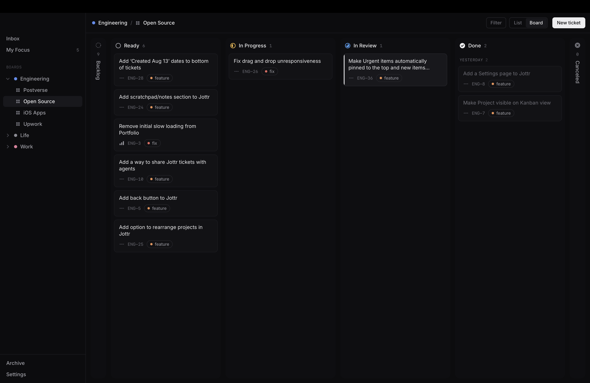

# Jottr

A lightweight, fast Kanban app for macOS. Single-user and fully local: no account, no server, no network.



## Install

Download the latest `.dmg` from [Releases](https://github.com/steojo/jottr/releases) (Apple Silicon only). Jottr isn't notarized yet, so macOS blocks the first launch: drag Jottr to Applications and open it, then go to System Settings → Privacy & Security and click Open Anyway.

## Develop

```sh
npm install
npm run tauri dev     # run the app with live reload
npm run tauri build   # build Jottr.app and a .dmg
```

Requires Xcode Command Line Tools, Node.js and Rust (`rustup`).

## License

Licensed under the [MIT License](LICENSE).
