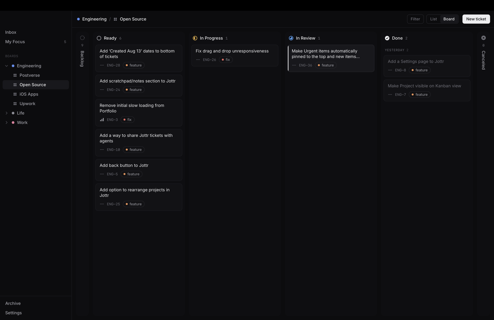

# Jottr

A lightweight, fast AI Agent native kanban app for macOS. Single-user and fully local: no account, no server, no network.



## Install

Download the latest `.dmg` from [Releases](https://github.com/steojo/jottr/releases) (Apple Silicon only). Jottr isn't notarized yet, so macOS blocks the first launch: drag Jottr to Applications and open it, then go to System Settings → Privacy & Security and click Open Anyway.

## Agent-native

Jottr works with AI coding agents like Claude Code and Codex. The app doubles as a command line, so an agent can read your boards and notes, make tickets and move them along while it works. Changes appear in the open app within a second, and everything stays on your Mac.

```sh
/Applications/Jottr.app/Contents/MacOS/jottr help                     # every command
/Applications/Jottr.app/Contents/MacOS/jottr tickets "ENG/iOS Apps"   # a project's open tickets
/Applications/Jottr.app/Contents/MacOS/jottr update ENG-28 --status in_review
/Applications/Jottr.app/Contents/MacOS/jottr append-note ENG "Notes" "- an idea"
```

To use it from any project, give your agent a skill or instruction that points at this command and `jottr help`.

Going the other way, **Copy for agent** (`⌘⌥C`, or right-click a ticket) copies a prompt you can paste into your agent. It names the ticket and how to read it, and asks the agent to move the ticket along as it works.

## Develop

```sh
npm install
npm run tauri dev     # run the app with live reload
npm run tauri build   # build Jottr.app and a .dmg
npm run install-app   # build Jottr.app and install it in /Applications
```

Requires Xcode Command Line Tools, Node.js and Rust (`rustup`).

## License

Licensed under the [MIT License](LICENSE).
